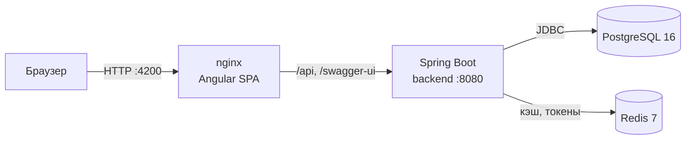
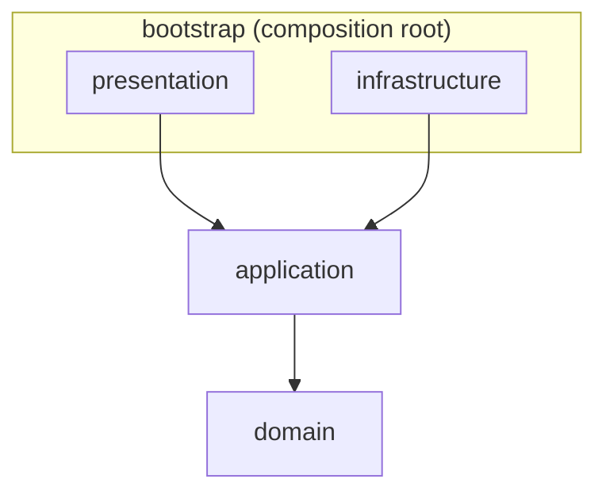
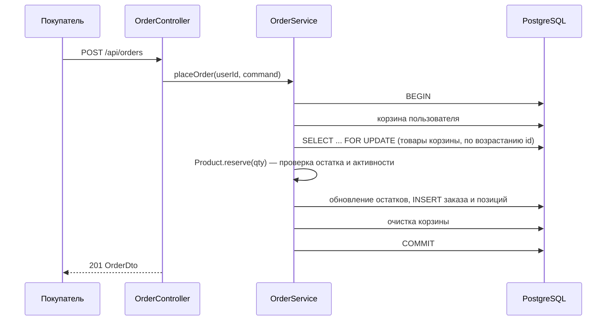

# Архитектура

## Общая схема

| Компонент  | Технологии | Назначение |
|------------|------------|------------|
| frontend   | Angular 20 (standalone-компоненты, signals), SCSS, nginx | Пользовательский интерфейс: витрина, корзина, заказы, панель управления |
| backend    | Java 17, Spring Boot 3.5, Spring Security, Spring Data JPA, Flyway, jjwt, springdoc-openapi | REST API, бизнес-логика, аутентификация и авторизация |
| PostgreSQL | 16 | Основное хранилище данных |
| Redis      | 7 | Кэш справочников и карточек товаров, refresh-токены, чёрный список access-токенов |

## Clean Architecture на бэкенде

Бэкенд разбит на Maven-модули, соответствующие слоям «чистой архитектуры».
Зависимости направлены строго внутрь: внутренние слои ничего не знают о внешних.

| Модуль | Пакет | Содержимое | Зависимости |
|--------|-------|------------|-------------|
| `domain` | `feehch.dev.autoparts.domain` | Сущности (`User`, `Product`, `Category`, `Brand`, `CarMake`, `CarModel`, `Cart`, `Order`), объекты-значения, перечисления (`Role`, `OrderStatus`, `PaymentMethod`), бизнес-правила и доменные исключения | только JDK |
| `application` | `feehch.dev.autoparts.application` | Сценарии использования (`AuthService`, `ProductService`, `CatalogService`, `CartService`, `OrderService`, `UserAdministrationService`, `ProfileService`, `StatsService`), команды и представления (View), **порты** (`port.out`): интерфейсы репозиториев, `PasswordHasher`, `TokenProvider`, `TokenStore`, `UnitOfWork` | `domain` |
| `infrastructure` | `feehch.dev.autoparts.infrastructure` | **Адаптеры** портов: JPA-сущности и репозитории, кэширование в Redis, `JwtTokenProvider`, `RedisTokenStore`, `BCryptPasswordHasher`, `JpaUnitOfWork`, конфигурация Spring Security, миграции Flyway | `application`, Spring Boot |
| `presentation` | `feehch.dev.autoparts.presentation` | REST-контроллеры, DTO запросов с Bean Validation, глобальный обработчик ошибок, конфигурация OpenAPI | `application`, Spring Web |
| `bootstrap` | `feehch.dev.autoparts` | Класс `AutopartsApplication`, `UseCaseConfig` (регистрация сценариев как бинов), `DemoUsersSeeder`, `application.yml`; собирает исполняемый jar | все модули |

### Ключевые решения

* **Независимость ядра от фреймворка.** Модули `domain` и `application` не зависят от Spring. Сценарии использования — обычные Java-классы,
  которые создаются в `UseCaseConfig` (composition root) с внедрением реализаций портов. Поэтому бизнес-логика тестируется
  простыми модульными тестами с Mockito, без поднятия Spring-контекста.
* **Инверсия зависимостей через порты.** Прикладной слой объявляет, *что* ему нужно (`ProductRepository`, `TokenStore`…),
  а инфраструктура реализует это (JPA, Redis). Замена PostgreSQL или Redis не затрагивает бизнес-логику.
* **Транзакции через порт `UnitOfWork`.** Сценарий явно оборачивает изменяющие операции в транзакцию
  (`unitOfWork.inTransaction(...)`); реализация `JpaUnitOfWork` использует `TransactionTemplate`.
* **Разделение доменной и JPA-модели.** JPA-сущности (`*Entity`) живут только в инфраструктуре; адаптеры преобразуют их
  в доменные объекты и обратно. Доменные объекты не содержат аннотаций ORM.
* **Богатая доменная модель.** Бизнес-правила реализованы в сущностях: конечный автомат статусов заказа (`OrderStatus`),
  списание и возврат остатков (`Product.reserve/release`), иерархия ролей (`Role.impliedRoles`), защита дерева категорий
  от циклов (`Category.ensureNoCycle`), снимок цены и названия товара в позиции заказа (`OrderItem`).

## Ключевые сценарии

### Оформление заказа

* Строки товаров блокируются пессимистично (`PESSIMISTIC_WRITE`) в фиксированном порядке — это исключает
  «перепродажу» остатков при одновременных заказах и взаимоблокировки.
* У `products` есть столбец `version` (оптимистическая блокировка) для конкурентного редактирования менеджерами.
* Отмена заказа (покупателем из `NEW` или менеджером из `NEW`/`CONFIRMED`) возвращает товары на склад в той же транзакции.

### Аутентификация

См. [security.md](security.md).

## Кэширование (Redis)

| Кэш | Ключи | TTL | Сброс |
|-----|-------|-----|-------|
| `categories` | `all`, `<id>` | 1 ч | при любом изменении категорий |
| `brands` | `all`, `<id>` | 1 ч | при изменении брендов |
| `car-makes` | `all`, `<id>` | 1 ч | при изменении марок |
| `car-models` | `all`, `make:<id>`, `<id>` | 1 ч | при изменении моделей или марок |
| `products` | `<id>` | 10 мин | при сохранении товара; полностью — при удалении модели автомобиля |

* Кэширование реализовано на уровне адаптеров репозиториев (`@Cacheable`/`@CacheEvict`) — это инфраструктурная деталь,
  прикладной слой о ней не знает.
* `RedisCacheManager` работает в режиме `transactionAware`: сброс кэша выполняется только после фиксации транзакции,
  поэтому в кэш не попадают незафиксированные данные.
* При недоступности Redis ошибки кэша логируются (`LoggingCacheErrorHandler`), а данные читаются из PostgreSQL.
* Результаты поиска не кэшируются (слишком много комбинаций фильтров), но поиск использует закэшированные справочники
  для подстановки названий брендов и категорий.

## Фронтенд

Структура `frontend/src/app`:

| Каталог | Содержимое |
|---------|------------|
| `core/models` | TypeScript-интерфейсы, повторяющие DTO API |
| `core/services` | Сервисы по областям API (auth, product, catalog, cart, order, user, stats), уведомления |
| `core/interceptors` | Добавление JWT, автоматическое обновление токена при 401, обработка ошибок |
| `core/guards` | `authGuard`, `roleGuard` (с учётом иерархии ролей), `guestGuard` |
| `shared` | Пагинация, тосты, бейджи статусов, пайпы (`rub`, статусы, роли, способы оплаты) |
| `features` | Ленивые разделы: каталог, карточка товара, корзина, оформление заказа, заказы, профиль, аутентификация, панель управления (`admin`) |

Состояние (текущий пользователь, количество товаров в корзине) хранится в сигналах Angular.
В production-сборке nginx раздаёт статику и проксирует `/api` на бэкенд, поэтому CORS не нужен.
