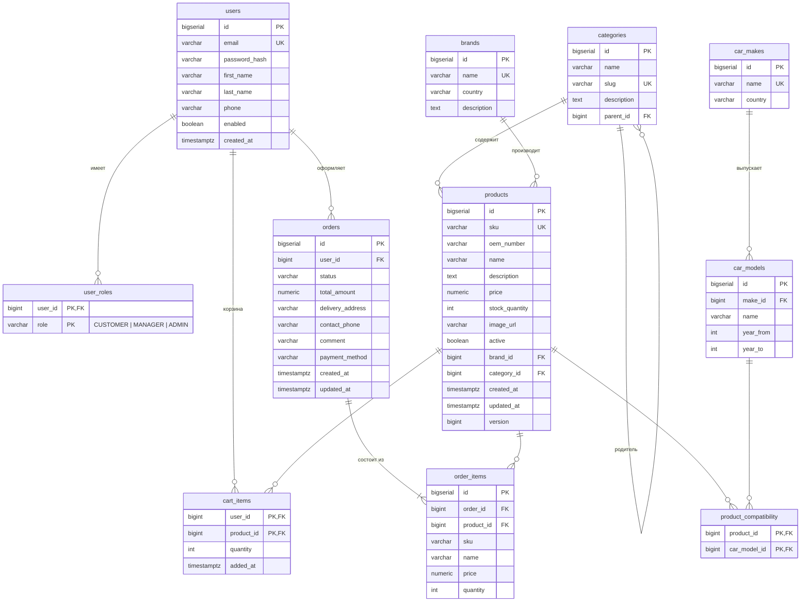

# База данных

СУБД — PostgreSQL 16. Схема создаётся и версионируется миграциями Flyway
(`backend/infrastructure/src/main/resources/db/migration`):

| Миграция | Содержимое |
|----------|------------|
| `V1__init_schema.sql` | Таблицы, ограничения, индексы |
| `V2__seed_catalog.sql` | Демонстрационный каталог: 19 категорий, 12 брендов, 7 марок, 15 моделей, 32 товара, совместимость |
| `V3__byn_prices_and_catalog_expansion.sql` | Переход на белорусские рубли (пересчёт цен и заказов), белорусские номера телефонов, расширение каталога в тех же категориях: +12 брендов (в т.ч. белорусский Fenox), +4 марки (Geely, Belgee, Renault, Audi), +7 моделей, +70 товаров — итого 102 товара; ссылки на изображения товаров |

Демонстрационные пользователи создаются не миграцией, а при старте приложения (`DemoUsersSeeder`), чтобы пароли
хешировались тем же алгоритмом, что и при регистрации. Hibernate работает в режиме `ddl-auto: validate`:
при расхождении JPA-модели и схемы приложение не запустится.

## ER-диаграмма



## Описание таблиц

| Таблица | Назначение | Важные ограничения |
|---------|------------|--------------------|
| `users` | Учётные записи | `email` уникален (хранится в нижнем регистре) |
| `user_roles` | Роли пользователя (многие-ко-многим с перечислением) | `CHECK role IN (...)`, каскадное удаление |
| `categories` | Дерево категорий каталога | `slug` уникален; `parent_id` → `categories.id` |
| `brands` | Производители запчастей | уникальность названия без учёта регистра (`lower(name)`) |
| `car_makes`, `car_models` | Марки и модели (поколения) автомобилей | `year_to IS NULL OR year_to >= year_from` |
| `products` | Запчасти | уникальный `sku`; `price >= 0`; `stock_quantity >= 0`; `version` для оптимистической блокировки; `active` — мягкое удаление |
| `product_compatibility` | Применимость запчасти к моделям автомобилей | составной PK, каскадное удаление |
| `cart_items` | Корзины покупателей | составной PK (`user_id`, `product_id`), `quantity > 0` |
| `orders` | Заказы | `CHECK` на статус и способ оплаты |
| `order_items` | Позиции заказа | хранят снимок `sku`, `name`, `price` на момент оформления |

## Индексы

* `products`: `category_id`, `brand_id`, `lower(name)`, `lower(oem_number)` — фильтрация и поиск по каталогу;
* `product_compatibility(car_model_id)` — подбор запчастей по автомобилю;
* `orders(user_id, created_at DESC)` — история заказов покупателя; `orders(status)` — фильтр менеджера;
* `car_models(make_id)`, `categories(parent_id)`, `order_items(order_id)`.

## Нормализация

Схема находится в третьей нормальной форме. Единственное сознательное отступление — денормализация
`order_items.sku/name/price` и `orders.total_amount`: заказ — это юридически значимый документ, и его содержимое не должно
меняться при последующем изменении цены или названия товара в каталоге.

## Подключение к БД

```bash
docker compose exec postgres psql -U autoparts -d autoparts
# или с хоста: psql -h localhost -p 5433 -U autoparts autoparts   (пароль autoparts)
```
