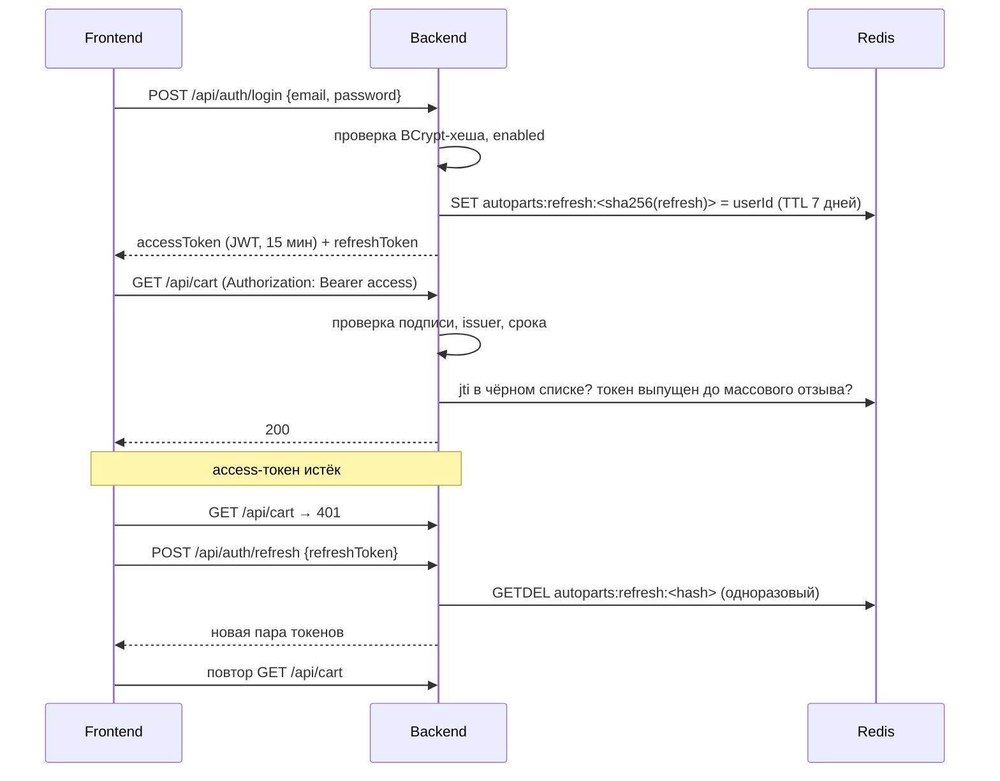

# Безопасность: аутентификация и распределение ролей

## Роли

| Роль | Права |
|------|-------|
| `CUSTOMER` (покупатель) | Просмотр каталога, корзина, оформление заказов, просмотр и отмена своих новых заказов, редактирование профиля |
| `MANAGER` (менеджер) | Права покупателя + управление каталогом (товары, категории, бренды, автомобили), просмотр всех заказов и смена их статусов, статистика |
| `ADMIN` (администратор) | Права менеджера + управление пользователями: создание, назначение ролей, блокировка |

Роли образуют иерархию `ADMIN ⊃ MANAGER ⊃ CUSTOMER` (`Role.impliedRoles()` в домене). При аутентификации пользователь
получает полномочия всех ролей, вложенных в его роли: например, администратор получает `ROLE_ADMIN`, `ROLE_MANAGER`
и `ROLE_CUSTOMER`. У пользователя может быть несколько ролей одновременно (таблица `user_roles`).

Новые пользователи, зарегистрировавшиеся через сайт, получают роль `CUSTOMER`. Роли назначает только администратор
(`PUT /api/users/{id}/roles`), он же может создать сотрудника сразу с нужными ролями (`POST /api/users`).

Ограничения:
* у пользователя всегда есть хотя бы одна роль;
* администратор не может снять с себя роль `ADMIN` и заблокировать сам себя — в системе всегда остаётся администратор.

## Проверка прав: три уровня

1. **URL-правила** в `SecurityConfig` — грубое разграничение: публичный каталог (`GET`), изменение каталога только для `MANAGER`,
   `/api/users/**` только для `ADMIN`, `/api/stats/**` только для `MANAGER`, остальное — для аутентифицированных.
   Эти правила срабатывают **до** разбора и валидации тела запроса.
2. **`@PreAuthorize`** на методах контроллеров — декларативная проверка ролей рядом с кодом эндпоинта.
3. **Проверки в сценариях использования** — правила, зависящие от данных: заказ может смотреть только его владелец
   или менеджер; отменить заказ может только владелец и только в статусе `NEW`; ограничения на самоизменение ролей.

## JWT-аутентификация

* **Access-токен** — JWT, подпись HMAC-SHA256. Полезная нагрузка: `sub` (id пользователя), `email`, `roles`, `jti`, `iat`, `exp`, `iss`.
  Время жизни — 15 минут (`app.jwt.access-token-ttl`).
* **Refresh-токен** — случайная строка (384 бита, `SecureRandom`), в Redis хранится только её SHA-256-хеш.
  Время жизни — 7 дней. Токен одноразовый: при обновлении старый удаляется атомарной операцией `GETDEL` (ротация),
  поэтому повторное использование перехваченного refresh-токена невозможно.
* **Выход** (`POST /api/auth/logout`) удаляет refresh-токен и вносит `jti` текущего access-токена в чёрный список
  (`autoparts:blacklist:<jti>`) на оставшийся срок его жизни.
* **Массовый отзыв.** При смене ролей или блокировке пользователя в Redis записывается момент
  `autoparts:revoked-before:<userId>`: все access-токены, выпущенные раньше, отклоняются. После смены ролей
  фронтенд автоматически получает новый access-токен по refresh-токену — уже с актуальными ролями.
  При блокировке удаляются и все refresh-токены пользователя, а вход блокированному пользователю запрещён (`403`).

## Прочие меры

* Пароли хранятся в виде BCrypt-хешей (cost 10); минимальная длина пароля — 8 символов.
* Сообщение при неудачном входе не раскрывает, существует ли email.
* Сервер не хранит сессии (`SessionCreationPolicy.STATELESS`), CSRF отключён, так как токен передаётся в заголовке, а не в cookie.
* CORS разрешён только для источников из `app.cors.allowed-origins` (для `ng serve`); в Docker фронтенд и API
  работают на одном источнике через nginx.
* Все входные данные проверяются Bean Validation на уровне DTO и инвариантами доменных сущностей; SQL-запросы
  строятся через JPA Criteria API и параметризованные запросы.
* Секрет JWT задаётся переменной окружения `JWT_SECRET` (не короче 32 байт); значение по умолчанию предназначено
  только для разработки.
* Ошибки 401/403 возвращаются в едином JSON-формате `ApiError`.
